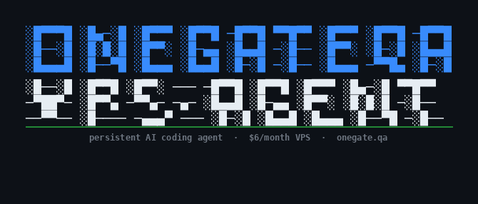

<p align="center">
  
</p>

<p align="center">

```
░█▀▀▀█ ░█▄─░█ ░█▀▀▀ ░█▀▀█ ─█▀▀█ ▀▀█▀▀ ░█▀▀▀ ░█▀▀█ ─█▀▀█
░█──░█ ░█░█░█ ░█▀▀░ ░█─▄▄ ░█▄▄█ ─░█── ░█▀▀░ ░█─░█ ░█▄▄█
░█▄▄▄█ ░█──▀█ ░█▄▄▄ ░█▄▄█ ░█─░█ ─░█── ░█▄▄▄ ─▀▀█▄ ░█─░█

░█──░█ ░█▀▀█ ░█▀▀░ ─── ─█▀▀█ ░█▀▀█ ░█▀▀▀ ░█▄─░█ ▀▀█▀▀
─▀██▀─ ░█▀▀▄ ─▀▀▄─ ─▄─ ░█▄▄█ ░█─▄▄ ░█▀▀░ ░█░█░█ ─░█──
──▀▀── ░█──── ─▄▄▄▀ ─── ░█─░█ ░█▄▄█ ░█▄▄▄ ░█──▀█ ─░█──
```

</p>

<p align="center">
  <a href="LICENSE"></a>
  
  
</p>

---

**vps-agent** runs your AI coding agent on a cheap VPS instead of your laptop. The session never dies. You SSH in from your phone at midnight, pick up exactly where you left off, and disconnect — the agent keeps working.

Your laptop session dies when you close the lid. A $6 VPS runs 24/7.

---

## What it does

One command bootstraps a fresh Ubuntu 24.04 VPS with a structured tmux workspace. Each project gets its own named session with four windows — agent, git, tests, logs. You SSH in from anywhere. The agent commits to branches and opens PRs. You review and merge. The agent never merges its own work.

```
ssh user@your-vps
attach.sh my-project        # pick up from anywhere
```

---

## Quick start

**1. Get a VPS** — any Ubuntu 24.04 host works.

| Provider | Spec | Price |
|---|---|---|
| [Hetzner CX22](https://hetzner.com) | 2 vCPU · 4 GB RAM · 40 GB | ~$4/mo |
| [DigitalOcean Basic](https://digitalocean.com) | 1 vCPU · 1 GB RAM · 25 GB | $6/mo |
| [Vultr Cloud Compute](https://vultr.com) | 1 vCPU · 1 GB RAM · 25 GB | $6/mo |

**2. Bootstrap**

```bash
git clone https://github.com/ONEGATEQA/vps-agent.git
cd vps-agent
sudo bash setup/bootstrap.sh
```

**3. Add your SSH key**

```bash
echo 'YOUR_PUBLIC_KEY' >> ~/.ssh/authorized_keys
```

**4. Start a project session**

```bash
bash scripts/new-session.sh my-project
```

**5. SSH in from anywhere**

```bash
ssh user@your-vps
attach.sh my-project
```

---

## Session layout

Every project gets four tmux windows:

```
tmux session: my-project
├── [0] agent    ← give tasks here, read output here
├── [1] git      ← branch management, PR checks
├── [2] tests    ← test runner
└── [3] logs     ← app/server output
```

Switch: `Ctrl+B` → window number. Detach: `Ctrl+B D`. Reconnect: `attach.sh`.

---

## Agent instructions

Drop `examples/AGENT.md` into your project repo as `AGENT.md`. It sets the rules:

- Agent commits to branches, never to main
- Agent opens PRs, never merges them
- Agent stops and reports — you decide what happens next

```markdown
## What requires my approval

- Merging any pull request
- Deploying to any environment
- Destructive database operations
- Any irreversible change
```

See [examples/AGENT.md](examples/AGENT.md) for the full template.

---

## Scripts

| Script | What it does |
|---|---|
| `setup/bootstrap.sh` | One-time VPS setup — packages, SSH hardening, firewall, tmux config |
| `scripts/new-session.sh <name>` | Create a new project session with 4 windows |
| `scripts/attach.sh [name]` | Attach to a session (interactive picker if no name given) |
| `scripts/list-sessions.sh` | Show all active sessions |
| `scripts/kill-session.sh <name>` | Clean up a session |

---

## SSH from your phone

iOS: [Blink Shell](https://blink.sh) · Android: [Termux](https://f-droid.org/en/packages/com.termux/)

Full guide: [docs/ssh-from-phone.md](docs/ssh-from-phone.md)

---

## Files

```
vps-agent/
├── setup/bootstrap.sh         one-time server setup
├── scripts/
│   ├── new-session.sh         create a project session
│   ├── attach.sh              attach from any device
│   ├── list-sessions.sh       list active sessions
│   └── kill-session.sh        remove a session
├── docs/
│   ├── workflow.md            the human/agent split model
│   └── ssh-from-phone.md      iOS and Android SSH setup
└── examples/
    └── AGENT.md               drop this in any project repo
```

---

## License

MIT — [onegate.qa](https://onegate.qa)
